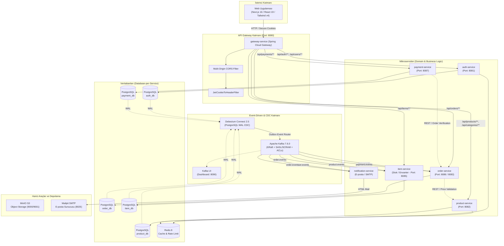
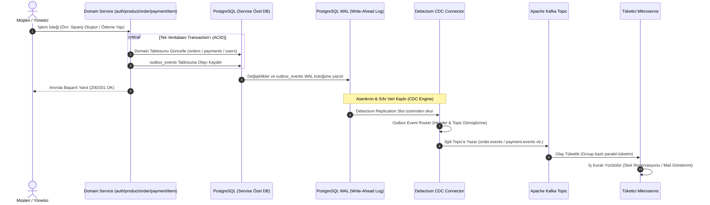
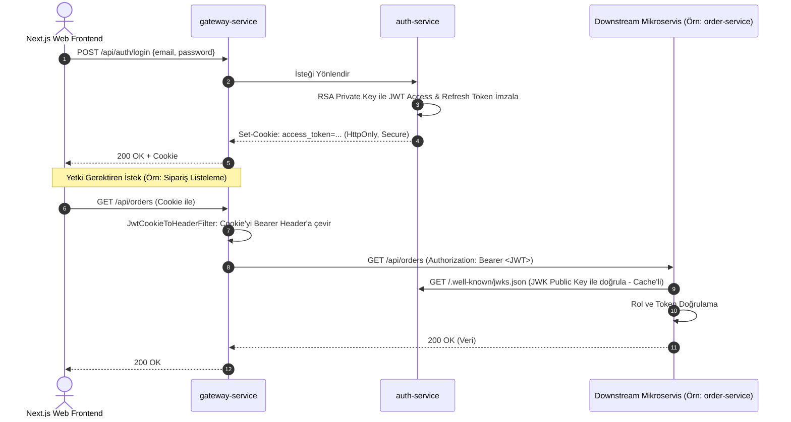

# 🛒 Vestra — Event-Driven E-Commerce Microservices Platform

<p align="center">
  
  
  
  
  
  
  
  
  
  
</p>

**Vestra**, modern yazılım mühendisliği prensipleri (**Event-Driven Architecture**, **Transactional Outbox Pattern**, **Change Data Capture - CDC**, **Database-per-Service**, **Choreography Saga**) ile tasarlanmış, yüksek ölçeklenebilir, dayanıklı ve uçtan uca güvenliği sıkılaştırılmış bir e-ticaret mikroservis ekosistemidir.

---

## 📑 İçindekiler

- [Sistem Mimarisi](#-sistem-mimarisi)
  - [Genel Bakış Şeması](#genel-bakış-şeması)
  - [Transactional Outbox & CDC Veri Akışı](#transactional-outbox--cdc-veri-akışı)
  - [Sipariş & Ödeme Dağıtık Yaşam Döngüsü (Choreography Saga)](#sipariş--ödeme-dağıtık-yaşam-döngüsü-choreography-saga)
  - [Kimlik Doğrulama (Auth) & Gateway Akışı](#kimlik-doğrulama-auth--gateway-akışı)
- [Kullanılan Teknolojiler (Tech Stack)](#-kullanılan-teknolojiler-tech-stack)
- [Mikroservisler ve Modüller](#-mikroservisler-ve-modüller)
- [Güvenlik Sıkılaştırması (Security Hardening)](#-güvenlik-sıkılaştırması-security-hardening)
- [Kafka Event & Topic Yapısı](#-kafka-event--topic-yapısı)
- [Hazır Mock Veriler & Test Kullanıcıları](#-hazır-mock-veriler--test-kullanıcıları)
- [Altyapı ve Docker Servisleri](#-altyapı-ve-docker-servisleri)
- [Kurulum ve Başlangıç (Getting Started)](#-kurulum-ve-başlangıç-getting-started)
  - [1. Önkoşullar](#1-önkoşullar)
  - [2. Altyapıyı Başlatma (Docker Compose)](#2-altyapıyı-başlatma-docker-compose)
  - [3. Backend Servislerini Çalıştırma](#3-backend-servislerini-çalıştırma)
  - [4. Frontend (Next.js) Uygulamasını Başlatma](#4-frontend-nextjs-uygulamasını-başlatma)
  - [5. Hızlı Erişim Bağlantıları](#5-hızlı-erişim-bağlantıları)
- [Proje Dizin Yapısı](#-proje-dizin-yapısı)
- [Gelecek Yol Haritası (Roadmap)](#-gelecek-yol-haritası-roadmap)

---

## 🏛️ Sistem Mimarisi

Vestra, monolitik bağımlılıkları tamamen ortadan kaldıran, servisler arası gevşek bağlılığı (*loose coupling*), sıfır veri kaybını (*at-least-once delivery*) ve nihai tutarlılığı (*eventual consistency*) merkezine alan dağıtık bir mimariye sahiptir.

### Genel Bakış Şeması



---

### Transactional Outbox & CDC Veri Akışı

Doğrudan uygulama içinden Kafka'ya mesaj üretmek "Dual-Write" problemine (veritabanına commit edilip Kafka'ya gönderilememesi veya tam tersi) yol açar. Vestra bu problemi **Transactional Outbox Pattern** ve **Debezium CDC (Change Data Capture)** ile çözer:



---

### Sipariş & Ödeme Dağıtık Yaşam Döngüsü (Choreography Saga)

Sipariş verme, stok teyidi, ödeme onayı ve teslimat aşamaları servisler arasında koreografi tabanlı bir asenkron olay zinciriyle yürütülür:

```mermaid
sequenceDiagram
    autonumber
    actor Customer as Müşteri
    participant Gateway as gateway-service
    participant Order as order-service
    participant Product as product-service
    participant Debezium as Debezium CDC
    participant Kafka as Kafka (Topics)
    participant Item as item-service (Stok)
    participant Notif as notification-service
    participant Payment as payment-service

    %% 1. Sipariş Oluşturma
    Customer->>Gateway: POST /api/orders (Sipariş Kalemleri)
    Gateway->>Order: İsteği İlet
    Order->>Product: GET /api/internal/products/variants/batch (Fiyat Doğrulama)
    Product-->>Order: Orijinal Birim Fiyatlar
    Note over Order: Price Tampering Koruması: Fiyat manipülasyonu engellenir
    Order->>Order: Siparişi PENDING olarak kaydet + outbox(ORDER_CREATED)
    Order-->>Customer: 201 Created (Sipariş Alındı)

    %% 2. CDC & Stok Kontrolü
    Order-)-Debezium: WAL CDC Okuma
    Debezium-)-Kafka: order.events [ORDER_CREATED]
    Kafka-)-Item: Tüket (item-group)
    Kafka-)-Notif: Tüket (notification-group)
    Notif-->>Customer: Sipariş Alındı E-postası Gönder (Mailpit)
    
    alt Stok Yeterli
        Item->>Item: Stokları Rezerve Et + outbox(STOCK_RESERVED_FOR_ORDER)
        Item-)-Debezium: WAL CDC Okuma
        Debezium-)-Kafka: item.events [STOCK_RESERVED_FOR_ORDER]
        Kafka-)-Order: Tüket -> Sipariş Durumunu STOCK_CONFIRMED Yap
    else Stok Yetersiz
        Item->>Item: outbox(STOCK_RESERVATION_FAILED)
        Item-)-Debezium: WAL CDC Okuma
        Debezium-)-Kafka: item.events [STOCK_RESERVATION_FAILED]
        Kafka-)-Order: Tüket -> Siparişi CANCELLED Yap
    end

    %% 3. Ödeme Süreci
    Customer->>Gateway: POST /api/payments (orderId, kart bilgileri)
    Gateway->>Payment: İsteği İlet
    Payment->>Order: GET /api/internal/orders/{orderId} (Doğrulama)
    Order-->>Payment: {userId, totalAmount, status}
    Note over Payment: Tutar & Sahiplik Doğrulaması (amount == order.amount, userId == order.userId)
    Payment->>Payment: PSP İşlemi + Tokenize Et + outbox(PAYMENT_COMPLETED)
    Payment-->>Customer: 200 OK (Ödeme Başarılı)

    %% 4. Ödeme Sonucu & Sipariş Güncelleme
    Payment-)-Debezium: WAL CDC Okuma
    Debezium-)-Kafka: payment.events [PAYMENT_COMPLETED]
    Kafka-)-Order: Tüket -> Sipariş Durumunu PAID Yap

    %% 5. Teslimat Süreci
    Note over Order: Yönetici Paneli: PAID -> SHIPPED -> DELIVERED / COMPLETED
```

---

### Kimlik Doğrulama (Auth) & Gateway Akışı

Vestra, web istemcisi tarafında **HttpOnly/Secure Cookie** yaklaşımını benimserken mikroservisler arasında **Stateless Asymmetric JWT (RSA 2048)** standardını kullanır:



---

## 🛠️ Kullanılan Teknolojiler (Tech Stack)

### Backend & Mikroservis Mimarisi
- **Dil & Runtime:** Java 25 (OpenJDK)
- **Framework:** Spring Boot 4.1.1 & Spring Framework 7
- **API Gateway:** Spring Cloud Gateway (Reactive WebFlux, non-blocking I/O)
- **Güvenlik & Auth:** Spring Security, OAuth2 Resource Server & Client (Google Social Login desteği)
- **Veri Erişimi & ORM:** Spring Data JPA, Hibernate, PostgreSQL JDBC Driver
- **Veritabanı Migration:** Flyway (`flyway-database-postgresql`)
- **İstemciler Arası İletişim:** OpenFeign (`spring-cloud-starter-openfeign`) & Spring RestClient
- **Eşleme & DTO:** MapStruct 1.6.3 & Lombok
- **Doğrulama:** Spring Boot Starter Validation (Hibernate Validator & Custom Annotations)
- **E-posta & Şablon:** Spring Boot Mail, Thymeleaf HTML Template Engine

### Mesajlaşma, Event-Driven & CDC
- **Mesaj Broker:** Apache Kafka 7.6.0 (KRaft modunda, Zookeeper gereksinimi olmaksızın)
- **Broker Güvenliği:** SASL/SCRAM kimlik doğrulaması & Topic ACL erişim kontrolleri
- **Change Data Capture (CDC):** Debezium Connect 2.5 (`io.debezium.transforms.outbox.EventRouter`)
- **Kafka İstemcisi:** Spring Kafka (`@KafkaListener`, `JsonConverter`)
- **Görselleştirme Konsolu:** Provectus Kafka UI (Cluster, Topic ve Consumer Group izleme)

### Veritabanı, Önbellek ve Depolama
- **İlişkisel Veritabanı:** PostgreSQL 18 (`wal_level=logical` ile CDC replikasyonu)
- **In-Memory Cache & Lock:** Redis 8 (Query caching, brute-force koruması, login kilitleme)
- **Nesne Depolama (Object Storage):** MinIO (S3 uyumlu ürün görseli ve medya depolama)
- **E-posta Test Sunucusu:** Mailpit (Lokal SMTP sunucusu ve web arayüzü)

### Frontend (Web UI)
- **Framework:** Next.js 16 (App Router mimarisi) & React 19
- **Stil & Tasarım:** Tailwind CSS v4, Lucide React Icons, Radix/Base UI, shadcn bileşenleri
- **Veri Yönetimi:** TanStack React Query v5 (Server State, Caching, Revalidation)
- **Tablolar & Formlar:** TanStack Table v9, React Hook Form, Zod v4 doğrulama
- **Grafikler & Etkileşim:** Recharts v3, @dnd-kit (Sürükle-bırak desteği), Sonner Toast Notifications

---

## 📦 Mikroservisler ve Modüller

| Modül / Servis | Port | Veritabanı / Broker | Sorumluluk & Özellikler |
| :--- | :---: | :--- | :--- |
| **`gateway-service`** | `8080` | Redis Reactive | Tek giriş noktası (Reverse Proxy), Dinamik Cookie-to-Bearer Token çevirici, Multi-Origin CORS yönetimi, Logging maskeleme. |
| **`auth-service`** | `8081` | `auth_db` (Postgres), Redis | Kullanıcı kaydı/girişi, RSA 2048 Asimetrik JWT üretimi, JWKS endpoint'i (`/.well-known/jwks.json`), Brute-force önleme, Google OAuth2, Outbox event üretimi. |
| **`product-service`** | `8082` | `product_db` (Postgres), Redis | Kategori, ürün, hiyerarşik varyant ve inceleme (review) yönetimi, Redis sorgu önbellekleme, varyant outbox event'leri. |
| **`order-service`** | `8086` / `8083` | `order_db` (Postgres), Kafka | Sipariş oluşturma, yaşam döngüsü yönetimi (`PENDING` -> `STOCK_CONFIRMED` -> `PAID` -> `SHIPPED` -> `DELIVERED` / `COMPLETED`), sunucu taraflı fiyat manipülasyonu engelleme, stok/ödeme olayları tüketimi. |
| **`payment-service`** | `8087` | `payment_db` (Postgres), Kafka | Ödeme işlemi yürütme, `order-service` ile tutar ve sipariş sahipliği doğrulama, tokenize kart saklama (PCI-DSS uyumlu), ödeme outbox event'leri. |
| **`item-service`** | `8085` | `item_db` (Postgres), Kafka | Stok ve envanter yönetimi. `product.events` ile otomatik stok oluşturma; `order.events` ile sipariş bazlı stok rezervasyonu ve serbest bırakma. |
| **`notification-service`** | — | Mailpit SMTP, Kafka | Asenkron bildirim servisi. `user.events` (hoş geldin, şifre sıfırlama) ve `order.events` (sipariş onayı) olaylarını dinleyerek Thymeleaf HTML e-postaları gönderir. |
| **`common`** | — | Shared Library | Servisler arası paylaşılan Event DTO'ları, Payload'lar (`OrderCreatedPayload`, `StockReservedPayload` vb.) ve ortak Enum'lar. |
| **`common-web`** | — | Shared Library | Ortak hata yönetimi (`ApiException`, `@RestControllerAdvice GlobalHandler` ile SQL/stack trace gizleme), Spring Boot auto-configuration desteği. |
| **`web`** | `3000` | HTTP / REST API | Next.js 16 & React 19 modern admin dashboard ve kullanıcı arayüzü (Auth sayfaları, kategori/ürün yönetimi, sipariş yaşam döngüsü yönetimi). |

---

## 🔒 Güvenlik Sıkılaştırması (Security Hardening)

Projeye uygulanan kurumsal seviyedeki güvenlik denetimleri ve mimari çözümler:

1. **RSA Anahtarları & Gizlilik:**
   - Eski anahtarlar depodan ve Git geçmişinden arındırıldı.
   - Geliştirme ortamı için PKCS#8 formatında yerel `certs/private_key.pem` ve `certs/public_key.pem` anahtar çifti oluşturuldu (`.gitignore` ile korumalı).
   - Production ortamı için `RSA_PRIVATE_KEY` ve `RSA_PUBLIC_KEY` ortam değişkeni desteği entegre edildi.
2. **Sunucu Taraflı Fiyat Manipülasyonu (Price Tampering) Koruması:**
   - İstemciden gelen `unitPrice` değerlerine asla güvenilmez. `order-service`, sipariş oluşturulurken ürün varyant fiyatlarını doğrudan `product-service` üzerinden sorgular ve doğrular.
3. **Ödeme Tutarı ve Sahiplik Doğrulaması:**
   - `payment-service`, istemciden gelen ödeme tutarını ve kullanıcı kimliğini `order-service` dahili API'si üzerinden doğrular (`userId == order.userId` ve `amount == order.totalAmount`).
4. **Debezium & Veritabanı Şifre İzolasyonu:**
   - Debezium connector JSON dosyalarındaki ve veritabanı başlatma scriptlerindeki sabit parolalar parametrik hale getirildi (`${POSTGRES_PASSWORD}`).
5. **Kafka SASL/SCRAM & Topic ACL'leri:**
   - Broker'lar arası ve istemci bağlantıları için SASL/SCRAM kimlik doğrulaması ve topic bazlı okuma/yazma ACL kuralları (`setup-acls.sh`) kurgulandı.
6. **Gateway Hassas Veri Maskeleme:**
   - `gateway-service` genelinde `logging.level.root: info` seviyesine çekilerek token ve Authorization başlıklarının konsola sızması engellendi.
7. **Kart Verisi Tokenizasyonu (PCI-DSS Standardı):**
   - Ham kart numarası ve CVV verisi veritabanına kaydedilmez; yalnızca kartın son 4 hanesi ve sağlayıcı referans token'ı saklanır.
8. **Merkezi Hata Maskeleme (Information Leakage Prevention):**
   - `common-web` modülündeki `GlobalHandler` bileşenine genel `@ExceptionHandler(Exception.class)` eklenerek veritabanı şeması veya Java stack trace sızıntıları engellendi.
9. **Katı DTO Doğrulamaları:**
   - Tüm istek DTO'larına (`LoginRequest`, `RegisterRequest`, `CreateOrderRequest` vb.) `@Valid`, `@NotBlank`, `@Email` kuralları eksiksiz tanımlandı.
10. **Çoklu Origin CORS Desteği:**
    - Gateway CORS konfigürasyonu virgülle ayrılmış birden fazla origin adresini (`ALLOWED_ORIGINS`) dinamik destekleyecek şekilde güncellendi.

---

## 📬 Kafka Event & Topic Yapısı

| Topic Adı | Kaynak Servis | Tüketici (Consumer) | Event Tipi (`event_type` Header) | Açıklama |
| :--- | :--- | :--- | :--- | :--- |
| **`user.events`** | `auth-service` | `notification-service` | `USER_REGISTERED` | Yeni kullanıcı kaydında hoş geldin e-postası tetikler. |
| **`user.events`** | `auth-service` | `notification-service` | `PASSWORD_RESET` | Şifre sıfırlama linki ve güvenlik token'ını e-posta iletir. |
| **`product.events`** | `product-service` | `item-service` | `VARIANT_CREATED` | Yeni varyant eklendiğinde stok kaydı oluşturur. |
| **`product.events`** | `product-service` | `item-service` | `VARIANT_DELETED` | Varyant silindiğinde stok kaydını temizler. |
| **`order.events`** | `order-service` | `item-service` | `ORDER_CREATED` | Sipariş kalemleri için stok rezervasyonunu tetikler. |
| **`order.events`** | `order-service` | `item-service` | `ORDER_CANCELLED` | İptal edilen siparişin rezerve stoklarını iade eder. |
| **`order.events`** | `order-service` | `notification-service` | `ORDER_CREATED` | Müşteriye sipariş onay bildirimi gönderir. |
| **`item.events`** | `item-service` | `order-service` | `STOCK_RESERVED_FOR_ORDER` | Stok ayrıldığında sipariş durumunu `STOCK_CONFIRMED` yapar. |
| **`item.events`** | `item-service` | `order-service` | `STOCK_RESERVATION_FAILED` | Yetersiz stokta sipariş durumunu `CANCELLED` yapar. |
| **`payment.events`** | `payment-service` | `order-service` | `PAYMENT_COMPLETED` | Başarılı ödemede sipariş durumunu `PAID` yapar. |
| **`payment.events`** | `payment-service` | `order-service` | `PAYMENT_FAILED` | Başarısız ödemede siparişi iptal durumuna çeker. |

---

## 👥 Hazır Mock Veriler & Test Kullanıcıları

Flyway migration scriptleri sayesinde altyapı başlatıldığında tüm test verileri hazır olarak veritabanlarına yüklenir:

### Test Kullanıcıları
Tüm mock kullanıcılar için varsayılan şifre: **`Password123!`**

| Rol | Ad Soyad | E-posta | Amaç |
| :--- | :--- | :--- | :--- |
| **ADMIN** | Admin Vestra | `admin@vestra.com` | Yönetim paneli, ürün, kategori ve sipariş yönetimi |
| **CUSTOMER** | Ahmet Yılmaz | `ahmet.yilmaz@vestra.com` | Sipariş oluşturma, ödeme yapma ve sepet senaryoları |
| **CUSTOMER** | Ayşe Kaya | `ayse.kaya@vestra.com` | Sipariş geçmişi ve profil testleri |
| **CUSTOMER** | Mehmet Demir | `mehmet.demir@vestra.com` | Genel müşteri testleri |

### Yüklenen Örnek Katalog ve Sipariş Verileri:
- **Kategoriler:** Elektronik, Giyim, Aksesuar
- **Ürünler & Varyantlar:** Vestra Studio ANC Kulaklık, Apex Akıllı Saat, Oversize T-Shirt, Slim Fit Denim Jean, Deri Cüzdan
- **Hazır Stoklar:** Her varyant için 25 ile 150 adet arası başlangıç stokları
- **Örnek Siparişler:**
  - `ORD-2026-001` (`COMPLETED`) — Teslim edilmiş ve ödenmiş sipariş
  - `ORD-2026-002` (`SHIPPED`) — Kargoya verilmiş sipariş
  - `ORD-2026-003` (`PENDING`) — Ödeme bekleyen yeni sipariş

---

## 🐳 Altyapı ve Docker Servisleri

Tüm altyapı bileşenleri [infra/docker-compose.infra.yml](file:///C:/Users/Admin/Desktop/workspaces/vestra/infra/docker-compose.infra.yml) dosyasında tanımlıdır:

| Servis Adı | Konteyner Adı | Host Portu | Konteyner İçi | Açıklama |
| :--- | :--- | :---: | :---: | :--- |
| **PostgreSQL 18** | `vestra-postgres` | `5432` | `5432` | 5 veritabanı (`auth_db`, `product_db`, `item_db`, `order_db`, `payment_db`) + Logical WAL açık. |
| **Redis 8** | `vestra-redis` | `6379` | `6379` | Parola korumalı Redis (Önbellek & Güvenlik). |
| **Apache Kafka** | `vestra-kafka` | `9092` | `29092` | Confluent CP-Kafka (KRaft Broker + Controller + SASL). |
| **Kafka UI** | `vestra-kafka-ui` | `8090` | `8080` | Kafka görsel yönetim konsolu (`http://localhost:8090`). |
| **Debezium Connect**| `vestra-debezium` | `8083` | `8083` | PostgreSQL CDC Outbox Event Router motoru. |
| **Debezium Init** | `vestra-debezium-init`| — | — | Tüm servislerin outbox connector'larını otomatik kaydeden init konteyneri. |
| **MinIO** | `minio` | `9000` / `9001` | `9000` / `9001` | S3 API (`9000`) & Web Yönetim Konsolu (`9001`). |
| **Mailpit** | `mailpit` | `1025` / `8025` | `1025` / `8025` | SMTP portu (`1025`) & Web Posta Kutusu Arayüzü (`8025`). |

---

## 🚀 Kurulum ve Başlangıç (Getting Started)

### 1. Önkoşullar
- **Java 25 SDK** (Oracle OpenJDK veya Eclipse Temurin)
- **Node.js 20+** & **npm**
- **Docker Desktop** & **Docker Compose**

### 2. Altyapıyı Başlatma (Docker Compose)

Docker ağını ve altyapı konteynerlerini ayağa kaldırın:

```bash
# Proje kök dizininde veya infra dizininde:
cd infra

# Docker network'ünü oluşturun (eğer yoksa):
docker network create vestra-network

# Konteynerleri başlatın (Debezium connector'ları otomatik kaydedilecektir):
docker compose -f docker-compose.infra.yml -f docker-compose.override.yml up -d
```

> [!NOTE]
> `debezium-init` konteyneri `auth`, `product`, `item`, `order` ve `payment` outbox connector'larını otomatik olarak Debezium Connect'e kaydeder. Kayıt durumunu kontrol etmek için:
> `curl -s http://localhost:8083/connectors`

### 3. Backend Servislerini Çalıştırma

Gradle wrapper kullanarak mikroservisleri başlatabilirsiniz (her servisi ayrı bir terminal sekmesinde veya IDE üzerinden çalıştırabilirsiniz):

```bash
# 1. API Gateway
./gradlew :gateway-service:bootRun

# 2. Auth Service (Kimlik Doğrulama & Kullanıcı)
./gradlew :auth-service:bootRun

# 3. Product Service (Ürün & Kategori)
./gradlew :product-service:bootRun

# 4. Item Service (Stok & Envanter)
./gradlew :item-service:bootRun

# 5. Order Service (Sipariş Yönetimi)
./gradlew :order-service:bootRun

# 6. Payment Service (Ödeme)
./gradlew :payment-service:bootRun

# 7. Notification Service (E-posta Bildirimleri)
./gradlew :notification-service:bootRun
```

### 4. Frontend (Next.js) Uygulamasını Başlatma

```bash
cd web

# Bağımlılıkları yükleyin:
npm install

# Geliştirme sunucusunu başlatın:
npm run dev
```

### 5. Hızlı Erişim Bağlantıları

| Hizmet | Adres | Kimlik Bilgileri / Not |
| :--- | :--- | :--- |
| **Web UI (Müşteri & Admin)** | `http://localhost:3000` | `admin@vestra.com` / `Password123!` |
| **API Gateway** | `http://localhost:8080` | Giriş kapısı (Reverse proxy) |
| **Kafka UI** | `http://localhost:8090` | Topic ve tüketici grup izleme |
| **Mailpit (Web Mailbox)** | `http://localhost:8025` | Giden e-postaları izleme |
| **MinIO Console** | `http://localhost:9001` | `minioadmin` / `minioadmin` |
| **Debezium Connect REST** | `http://localhost:8083/connectors` | Aktif CDC connector listesi |

---

## 📂 Proje Dizin Yapısı

```text
vestra/
├── gateway-service/         # Spring Cloud Gateway, Dynamic Cookie-to-Bearer filter, CORS
├── auth-service/            # Kimlik doğrulama, JWT, OAuth2, RSA anahtarları, Brute-force koruması
│   ├── src/main/resources/certs/   # RSA private & public anahtarları (.pem)
│   └── src/main/resources/db/migration/ # V1-V4 Flyway tabloları ve mock kullanıcılar
├── product-service/         # Ürün kataloğu, hiyerarşik kategoriler, varyantlar, incelemeler
│   └── src/main/resources/db/migration/ # V1-V4 Flyway tabloları ve mock ürünler
├── order-service/           # Sipariş yönetimi, price tampering koruması, durum yaşam döngüsü
│   └── src/main/resources/db/migration/ # V1-V3 Flyway tabloları ve mock siparişler
├── payment-service/         # Ödeme entegrasyonu, tutar doğrulaması, kart tokenizasyonu
│   └── src/main/resources/db/migration/ # V1-V2 Flyway tabloları ve mock ödemeler
├── item-service/            # Envanter ve stok mikroservisi (Kafka Consumer/Producer)
│   └── src/main/resources/db/migration/ # V1-V5 Flyway tabloları ve mock stoklar
├── notification-service/    # Asenkron e-posta bildirim servisi (Thymeleaf + SMTP Mailpit)
├── common/                  # Ortak DTO'lar, Event Payload'lar, Role enum
├── common-web/              # Global Handler, ApiException, güvenlik maskelemeleri
├── infra/                   # Docker Compose, init SQL scriptleri, Kafka ACL ve Debezium
│   ├── debezium/            # Otomatik connector kayıt scripti ve connector tanımları
│   ├── init-scripts/        # 5 veritabanını oluşturan init-databases.sql
│   ├── kafka/               # SASL/SCRAM ve Topic ACL yapılandırma scriptleri
│   ├── docker-compose.infra.yml
│   └── docker-compose.override.yml
├── web/                     # Next.js 16, React 19, Tailwind CSS v4 Frontend
│   ├── app/                 # App Router (auth, dashboard/orders, dashboard/products)
│   ├── components/          # UI bileşenleri ve Dialog'lar
│   ├── hooks/               # TanStack React Query özel hook'ları
│   └── types/               # TypeScript veri modelleri ve enum'lar
├── build.gradle.kts         # Multi-project Gradle konfigürasyonu
├── settings.gradle.kts      # Modül tanımlamaları
└── README.md                # Proje dokümantasyonu
```

---

## 🗺️ Gelecek Yol Haritası (Roadmap)

Vestra mimarisi yeni yeteneklerin kolayca eklenebileceği şekilde tasarlanmıştır:

- [x] **`order-service` Entegrasyonu:** Sepet, sipariş oluşturma, sunucu taraflı fiyat doğrulaması ve sipariş yaşam döngüsü.
- [x] **`payment-service` Entegrasyonu:** Sipariş tutarı/sahipliği doğrulaması, kart tokenizasyonu ve ödeme olayları akışı.
- [x] **Dağıtık Koreografi (Choreography Saga):** Sipariş -> Stok Rezervasyonu -> Ödeme -> Sipariş Tamamlama uçtan uca akışı.
- [x] **Altyapı Otomasyonu:** Debezium connector'larının otomatik kaydı ve test mock verilerinin Flyway ile yüklenmesi.
- [x] **Güvenlik Sıkılaştırması:** 10 maddelik denetim (RSA, Parametrik Parolalar, ACL'ler, Global Exception Maskeleme).
- [ ] **Gözlemlenebilirlik (Observability):**
  - OpenTelemetry, Micrometer, Prometheus, Grafana ve Jaeger/Zipkin ile uçtan uca distributed tracing.
- [ ] **Resilience & Rate Limiting:**
  - Gateway üzerinde Redis tabanlı Request Rate Limiter ve Resilience4j Circuit Breaker entegrasyonu.
- [ ] **Kubernetes (K8s) & CI/CD:**
  - Production ortamına hazır Helm charts, Kubernetes deployment manifestoları ve GitHub Actions pipeline'ı.
